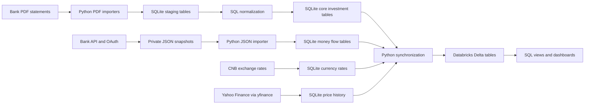

# Personal Finance Data Pipeline

Python, SQL, SQLite, and Databricks for combining bank transactions and investment data across multiple currencies.

This project turns bank PDF statements and authenticated bank API responses into structured local data, enriches investment records with market prices and Czech National Bank exchange rates, and publishes selected tables to Databricks for analysis.

**Status:** actively developed personal project. The Python ingestion and synchronization scripts are included here. Database bootstrap SQL, transformation SQL, and Databricks dashboard/view definitions are not yet packaged in this repository, so this is not yet a complete fresh-clone setup.

## The problem

Bank statements describe the same financial concepts differently: gold quantities are measured in grams, equities in shares, cash transactions have debit/credit directions, and investments settle in different currencies. A useful portfolio analysis needs consistent asset identifiers, transaction types, quantities, and historical currency conversion.

The project separates source extraction from normalization and reporting so that the original records can be traced while calculations evolve.

## Architecture



The diagram describes the working local workflow. SQL normalization and dashboard definitions currently live outside the checked-in Python files.

## Included components

| Component | Responsibility |
| --- | --- |
| `import_pdf_to_db.py` | Extract İş Bankası and VakıfBank statements into SQLite staging tables. |
| `import_ceska_pdf_to_db.py` | Extract completed trades, dividends, and supported fees from Česká spořitelna PDFs. |
| `web_app.py` | Run a local OAuth flow and download paginated bank API responses into timestamped JSON snapshots. |
| `import_json_to_db.py` | Import the latest JSON snapshot into money flow account, balance, and transaction tables. |
| `import_cnb_fx_rates.py` | Download yearly CNB rates and normalize quotes to CZK per one unit of foreign currency. |
| `stock_prices.py` | Retrieve market price history and map provider symbols to internal asset names. |
| `sync_to_databricks.py` | Copy selected SQLite tables into Databricks using temporary staging tables and target replacement. |

## Data engineering decisions

- **Repeatable imports:** SQLite unique keys and upserts update matching records instead of blindly appending every run. PDF transaction keys include normalized source fields and an occurrence counter. Source-format changes can still affect matching.
- **Traceability:** PDF staging records retain source filenames and raw extracted text; API imports retain original payloads locally.
- **Pagination validation:** the API exporter checks returned page numbers and rejects repeated or skipped pages before saving a completed response set.
- **Money representation:** cash flow transactions use integer minor units. Other monetary fields vary by layer; the project does not yet apply one precision policy throughout.
- **Historical FX:** the local workflow converts transactions using rates available on or before the transaction date. CNB currencies quoted in multiples are normalized per unit.
- **Explicit destinations:** investment data is published to the configured portfolio schema; cash flow transactions are published to the `money_flow` schema.

## Local setup

Development uses Python 3.14 on Windows. `requirements.txt` records the currently installed direct dependency versions; a clean-environment installation has not yet been verified.

```powershell
python -m venv .venv
.\.venv\Scripts\Activate.ps1
python -m pip install -r requirements.txt
Copy-Item .env.example .env
```

Fill in your own configuration in `.env`. Bank access requires a registered application, matching OAuth endpoints, and an approved callback URL. Databricks synchronization uses an SQL warehouse and interactive OAuth authentication.

**Before running imports:** prepare the SQLite schema. Only the Turkish PDF importer creates its own staging tables; the other importers expect existing tables. A versioned bootstrap script is a planned addition.

Private runtime locations, excluded from Git:

```text
DataBase/financials.db          Local database
DataBase/raw_json/              Timestamped bank API exports
pdf/                           İş Bankası and VakıfBank statements
pdf/ceska_pdf/                  Česká spořitelna statements
.env                           Local credentials and connection settings
```

The intended investment refresh order is PDF import, staging-to-core SQL, FX and price refresh, any required FX/asset-ID transformations, then Databricks synchronization. Cash flow uses `web_app.py`, then `import_json_to_db.py`, followed by synchronization.

## Current limitations

- SQL schema, transformation, and dashboard/view definitions still need to be exported and versioned. The `sql/` directory is currently empty.
- There is no committed automated test suite yet. Syntax checks alone do not establish correct financial calculations.
- The ticker mapping is manually maintained. Some prices use a different exchange from the bank's execution venue. Gold futures are a valuation proxy, not a bank gram-gold quote.
- The local price script currently converts timestamps to UTC before extracting dates, which can shift exchange-local dates. This needs correction and a review of existing price rows.
- Price adjustment behavior must be reconciled with corporate-action quantity changes before relying on historical valuations.
- Databricks synchronization replaces destination table contents. If prices or FX are maintained directly in Databricks, disable those mappings in the local sync before running it.
- Summed buys minus sells is net trade cash outflow; it is not automatically external deposits or the remaining holdings' cost basis.
- Portfolio views and dashboard screenshots are not yet included. Any future public demonstration will use synthetic data.

## Publication roadmap

- [ ] Add schema-only SQL and versioned staging-to-core transformations.
- [ ] Export the Databricks views and document their reporting grain.
- [ ] Add synthetic fixtures and tests for repeated imports, sales, corporate actions, and FX fallback dates.
- [ ] Provide a demo that runs without bank credentials or personal statements.
- [ ] Add dashboard screenshots generated from synthetic data.
- [ ] Validate setup in a clean environment and automate the relevant checks.

## Privacy

Credentials, bank statements, JSON exports, SQLite databases, and backups are excluded from Git. `.env.example` contains example configuration only. The repository is intended to publish code and documentation, not personal financial records.

See [the publication guide](docs/publishing.md) for the first upload and review checklist.
